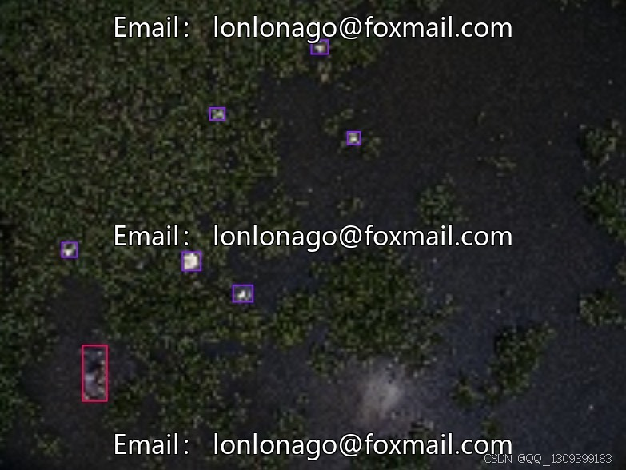
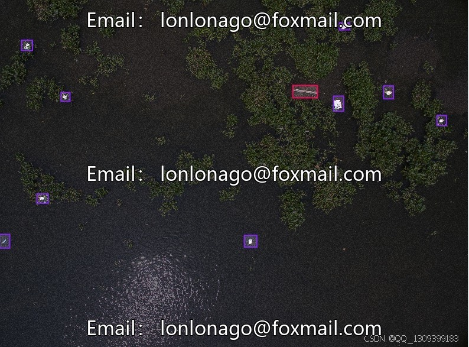
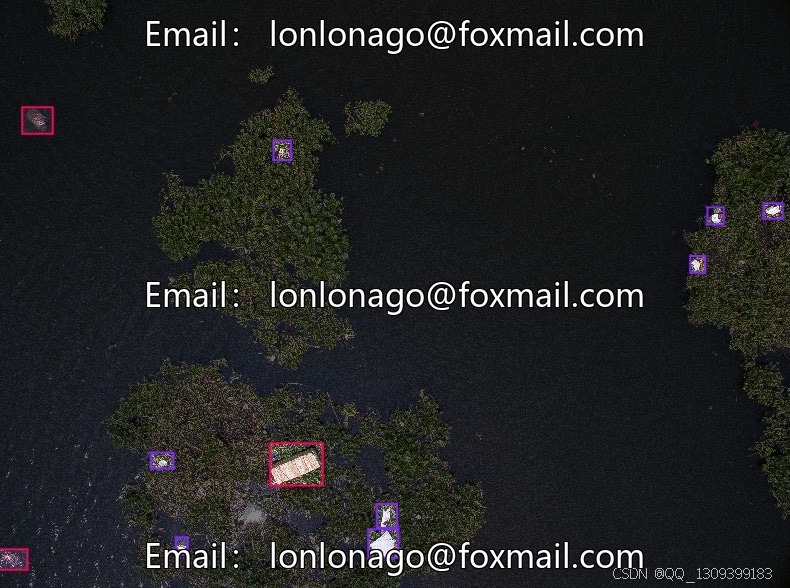
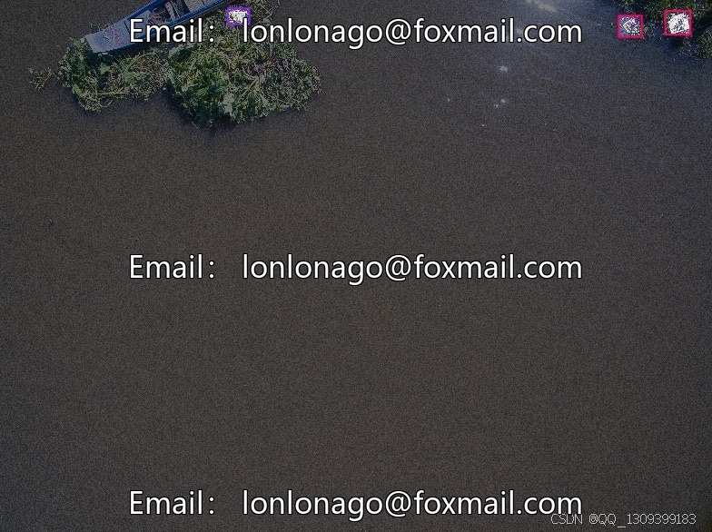

# UAV Drone Aerial Photography Inspection Data Set, River Channel Plastic and Garbage Object Detection Data Set

## Body

UAV Drone Aerial Photography Inspection Data Set, River Pollution Identification Target Detection Data Set, Issue 10075
The dataset is targeted at target detection, focusing on river pollution identification, including river trash and plastic waste.
Version 4 contains a total of 4000 images, split into 84%, 12%, and 4% for training set (3360), valid set (480), and test set (160) respectively. The data size and split are reasonable, supporting multiple version updates. Suitable for river pollution monitoring and environmental protection, AI model training, automatic recognition of river pollutants, and improving monitoring efficiency.
Virtual materials, once sold, are non-refundable.
Interested friends can click "I want" to proceed.

## Images

## Payment

Here is a pay link on Stripe ( https://buy.stripe.com/3cs8yP7sY87d0vu9AB ). Please contact me lonlonago@foxmail.com after funding $89, and I will send you a complete data files , thank you!

